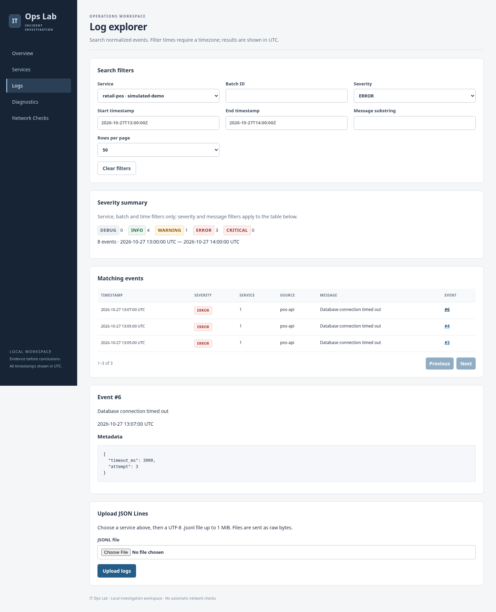
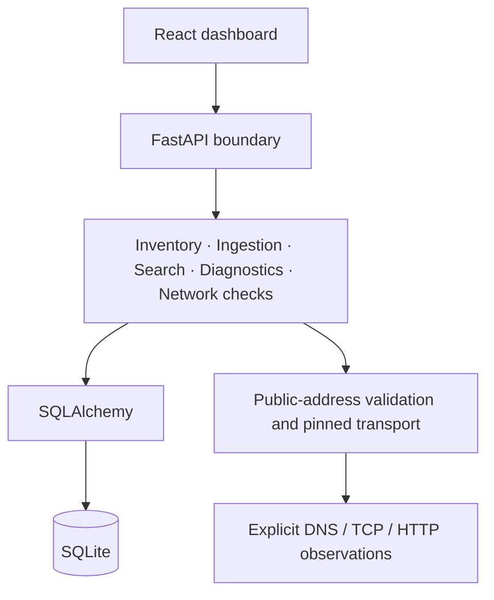

# IT Ops Lab

A local-first troubleshooting workspace for investigating application errors and
connectivity problems. It brings service inventory, searchable logs, diagnostic
findings and network observations into one interface, with links back to the
underlying evidence.

Built as a portfolio project for Application Support, Technical Support, IT
Operations, NOC/Network Support and Infrastructure Support roles. Demonstrations use synthetic retail POS logs;
this is not a production monitoring platform.

## Capabilities

- Register services and their environments.
- Ingest bounded UTF-8 JSONL uploads with partial success and line-level rejection reasons.
- Search stored events with SQL-backed filters, UTC time ranges and server pagination.
- Detect repeated timeouts, authentication failures and database connection errors.
- Retain historical diagnostic runs and their supporting event associations.
- Run explicitly registered public-only DNS, TCP and HTTP/HTTPS checks and inspect history.
- Investigate through a responsive React dashboard without manually entering record IDs.

A finding suggests what to investigate; it does not prove a root cause. Current
connectivity checks do not establish what caused an earlier application failure.

## Screenshots

Captured from the actual application with synthetic persisted records. Network
observations are explicitly simulated, not measurements of production services.




[Diagnostic evidence](docs/screenshots/diagnostics.png) ·
[Network history](docs/screenshots/network.png) ·
[Mobile layout](docs/screenshots/logs-mobile.png)

## Stack and architecture

| Layer | Tools |
| --- | --- |
| Backend | Python 3.12, FastAPI, Pydantic, SQLAlchemy 2.x, SQLite, Alembic, pytest, Ruff |
| Frontend | React, TypeScript, Vite, React Router, Fetch, Vitest, Testing Library, Prettier |
| Networking | Python sockets, HTTPX/httpcore, verified TLS, pinned public addresses |



One modular monolith keeps setup understandable. SQLite avoids a separate database
server; deterministic rules keep findings testable; isolated transports make network
failures reproducible with mocks. The frontend never accesses SQLite directly.
Read [architecture and trade-offs](docs/architecture.md).

## Quick start — Windows PowerShell

Requires Python 3.12 and Node 24 LTS. From the repository root:

```powershell
py -3.12 -m venv .venv
.\.venv\Scripts\python.exe -m pip install --upgrade 'pip>=26.2'
.\.venv\Scripts\python.exe -m pip install -e '.[dev]'
# Create a NEW disposable file with synthetic logs, findings and simulated observations.
.\.venv\Scripts\python.exe scripts/demo_network_diagnostics.py --database .\portfolio-demo.db
$demoPath = (Resolve-Path .\portfolio-demo.db).Path.Replace('\', '/')
$env:IT_OPS_DATABASE_URL = "sqlite:///$demoPath"
.\.venv\Scripts\python.exe -m alembic upgrade head
.\.venv\Scripts\python.exe -m uvicorn app.main:create_app --factory --reload --host 127.0.0.1
```

The seed command **refuses existing files**, including symlinks. For another run,
choose a new filename and update `$demoPath`; do not delete your normal database.
Retained demo targets are disabled to prevent accidentally turning simulated history
into real network checks. No internet is needed for the demo after dependencies
are installed. Do not use `--reload` outside this local development workflow.

In a second terminal:

```powershell
cd frontend
npm ci
npm run dev
```

Open `http://127.0.0.1:5173` locally. FastAPI listens at `127.0.0.1:8000`, with API
documentation at `/docs`. Vite proxies `/api`; no permissive CORS settings are needed.
Both servers bind to localhost. Optional frontend settings are in
[frontend/.env.example](frontend/.env.example); never put credentials in Vite variables.

PowerShell commands are documented; the equivalent workflow and Chromium browser
checks were executed on Linux, not on Windows. For an empty workspace, omit seeding
and use your chosen database URL with `alembic upgrade head`.

## Investigate the POS incident

Follow the [repeatable walkthrough](docs/demo-walkthrough.md): select the demo service,
filter ERROR events, review severity counts, open the two HIGH findings and inspect
their shared supporting events. Then compare the three simulated DNS/TCP/HTTP
observations against the historical log times. The walkthrough also covers a fresh
upload, explicit re-analysis and an evidence-based incident hypothesis.

## Verification

```powershell
.\.venv\Scripts\python.exe -m pytest
.\.venv\Scripts\python.exe -m ruff check .
.\.venv\Scripts\python.exe -m ruff format --check .
# In frontend/
npm test
npm run typecheck
npm run format:check
npm run build
npm audit
npm audit --omit=dev
```

Python auditing uses isolated `pip-audit` tooling; commands and scope are in the
[security review](docs/security-review.md). See [release verification](docs/release-verification.md)
for actual test counts, versions, migration checks, browser evidence and warnings.
Audits are point-in-time advisory checks, not proof that software has no vulnerabilities.

## Security and limits

**There is no user authentication or authorization. Do not expose this application
publicly as-is.** Local binding is a convenience boundary, not an access-control system.

Network checks validate IPv4/IPv6 answers, block private/special destinations, pin
connections, verify TLS, avoid redirects and bound I/O. Uploaded messages are treated
as data, rendered as text, and never executed. SQLAlchemy binds user inputs. These
controls have limits; see the [review and deployment prerequisites](docs/security-review.md).

The application has no continuous monitoring, background checks, production alerting,
incident-management integration or public deployment. Diagnostics use phrase matching
within one batch. Network targets are public-only; proxy-only environments may fail.
SQLite has limited concurrent-write capacity. Python dependencies use version ranges
rather than a complete lockfile. Production frontend hosting is not configured.

## Explore the engineering

- [Architecture](docs/architecture.md) — modules, boundaries, data flow and trade-offs.
- [SQL investigations](docs/sql-investigations.md) — five executable SQLite queries.
- [Diagnostic engine](docs/diagnostic-engine.md) — rolling windows and evidence selection.
- [Network diagnostics](docs/network-diagnostics.md) — DNS, TCP, TLS and safety boundaries.
- [Dashboard](docs/dashboard.md) — routing, state, cancellation and pagination.
- [Detailed API reference](docs/api-reference.md) — contracts, configuration and examples.
- [Portfolio and interview materials](docs/portfolio-summary.md) — project description,
  resume bullets, interview questions and a two-minute demonstration.

All eight planned milestones are implemented. Publication, repository visibility,
licensing decisions and any future work remain the owner's choices.
