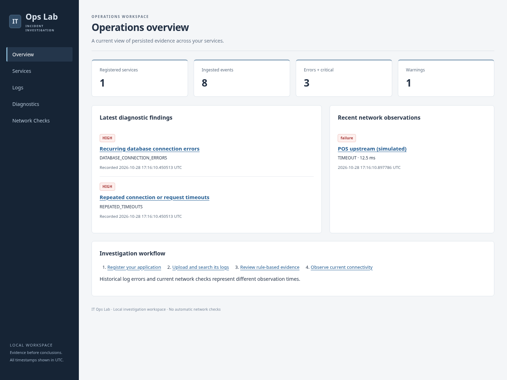

# IT Ops Lab

An IT operations and log diagnostics portfolio project. Milestones 1–7 provide a FastAPI foundation, SQLite service inventory,
validated JSON Lines ingestion, log search, SQL summaries, rule-based diagnostics,
registered public-only network checks, and a React investigation dashboard.

## Install

Requires Python 3.12 or newer. From the repository root:

```bash
python -m venv .venv
source .venv/bin/activate
python -m pip install -e '.[dev]'
python -m alembic upgrade head
```

On Windows PowerShell, activate with `.venv\Scripts\Activate.ps1` instead.
Dependencies use compatible version ranges; there is no lockfile yet.

## Run

```bash
python -m uvicorn app.main:create_app --factory --reload
```

The development server listens on `127.0.0.1:8000`. Interactive API documentation
is available at `/docs`.

```bash
curl --fail http://127.0.0.1:8000/health/live
# {"status":"alive"}
curl --fail http://127.0.0.1:8000/health/ready
# {"status":"ready"}
```

Liveness confirms the process can serve requests. Readiness queries the service, ingestion, diagnostic, and network tables and returns HTTP 503 with
`{"status":"not_ready"}` if the database is unavailable or unmigrated.
Liveness remains independent of database availability.

## Configuration and logging

Configuration is validated at application creation. Invalid values prevent startup.
Environment variables are optional:

| Variable | Default | Accepted values |
| --- | --- | --- |
| `IT_OPS_APP_NAME` | `IT Ops Lab` | Nonempty string |
| `IT_OPS_ENVIRONMENT` | `development` | `development`, `test`, `production` |
| `IT_OPS_DATABASE_URL` | `sqlite:///./it_ops_lab.db` | SQLite URL with a database path |
| `IT_OPS_LOG_LEVEL` | `INFO` | `DEBUG`, `INFO`, `WARNING`, `ERROR`, `CRITICAL` |

For example, `IT_OPS_LOG_LEVEL=DEBUG python -m uvicorn app.main:create_app --factory`.
The environment label does not itself enable production security settings.
No `.env` file is loaded automatically and no credentials are required.

Application request events are JSON lines on stdout with UTC timestamps, level,
logger, message, method, path, status, and duration. Query strings, headers, and
request bodies are not logged. Unhandled request exceptions are logged and re-raised.
Uvicorn keeps its own server/access log format. Paths and exception messages may
contain sensitive data; review logging before handling real operational data.

## Test and lint

```bash
python -m pytest
python -m ruff check .
python -m ruff format --check .
```

Tests cover health responses, environment configuration, invalid configuration,
request logging, and exception formatting. They require no external services.

## Structure and request flow

- `app/main.py`: application factory, request logging middleware, health routes.
- `app/config.py`: typed environment configuration and validation.
- `app/logging.py`: application logger and JSON formatter.
- `tests/test_foundation.py`: automated foundation checks.
- `pyproject.toml`: package metadata, dependencies, pytest and Ruff configuration.

Uvicorn creates the application through `create_app()`. Each HTTP request passes
through the logging middleware to FastAPI's matching route. FastAPI validates and
serializes the response model as JSON. The middleware logs completion and returns
the response through Uvicorn to the client.

This is a local development application. Authentication, diagnostic features,
deployment configuration, and CI are future work.


## Database and migrations

Run all commands from the repository root with the virtual environment activated.
The default database is `it_ops_lab.db` in the current directory and is ignored by
Git. The application never creates tables automatically; initialize before running:

```bash
python -m alembic upgrade head
python -m alembic current
```

To select another file, set `IT_OPS_DATABASE_URL=sqlite:////absolute/path/inventory.db`
for both Alembic and Uvicorn. Its parent directory must already exist. No database
credentials or separate server are required. Every application/migration SQLite
connection enables `PRAGMA foreign_keys=ON`.

To **erase all inventory data** and recreate the development schema:

```bash
# Stop the development server first. This destroys service records.
python -m alembic downgrade base
python -m alembic upgrade head
```

For subsequent schema changes, edit the models, then generate and review a migration:

```bash
python -m alembic revision --autogenerate -m "describe schema change"
python -m alembic upgrade head
python -m alembic check
```

`services` contains an integer primary key `id`, required `name` (up to 100
characters), required `environment` (up to 50), nullable `description` (up to 2000),
and required `created_at`. Names and environments are trimmed by request validation;
uniqueness is case-sensitive on `(name, environment)` and enforced in SQLite.
Environment names are free-form labels, separate from application configuration.
Creation timestamps are generated by the application in UTC and stored as naive
UTC values in SQLite; responses include the UTC offset. Services are referenced by uploaded log batches, described below. Length and whitespace validation are API rules;
SQLite enforces primary keys, required columns, and the unique pair.

## Service API examples

```bash
curl -X POST http://127.0.0.1:8000/api/v1/services \
  -H 'Content-Type: application/json' \
  -d '{"name":"billing","environment":"dev","description":"Payments API"}'
```

Example HTTP 201 response (ID and timestamp vary):

```json
{"id":1,"name":"billing","environment":"dev","description":"Payments API","created_at":"2026-10-27T18:00:00Z"}
```

```bash
curl 'http://127.0.0.1:8000/api/v1/services?offset=0&limit=50'
curl http://127.0.0.1:8000/api/v1/services/1
curl -X PATCH http://127.0.0.1:8000/api/v1/services/1 \
  -H 'Content-Type: application/json' -d '{"description":"Updated description"}'
```

The list returns a JSON array ordered by ID (default limit 50, maximum 100).
GET by ID and PATCH return a service object. PATCH changes only supplied fields;
`description: null` clears the description. Empty patches, null names/environments,
unknown fields, and invalid values return 422. Missing IDs return 404 with
`{"detail":"Service not found"}`. Duplicate name/environment combinations return
409 with `{"detail":"Service already exists in environment"}`. Failed writes roll
back without altering existing records.

## Inventory architecture and tests

- `app/database.py`: engine creation, SQLite connection policy, request sessions.
- `app/models.py`: SQLAlchemy service model and database constraint.
- `app/schemas.py`: Pydantic input/output contracts and UTC serialization.
- `app/inventory.py`: queries, transactions, and domain errors.
- `app/routes.py`: HTTP route adapters and pagination validation.
- `alembic.ini`, `migrations/`: migration configuration, environment, and schema history.
- `tests/conftest.py`: isolated temporary file database migrated for each test.
- `tests/test_inventory.py`: persistence across application instances, validation,
  conflicts, rollback, missing resources, migrations, foreign-key configuration,
  and unavailable-database readiness tests.

A request passes through logging middleware into FastAPI/Pydantic validation. The
route receives a request-scoped SQLAlchemy session and delegates to the inventory
module. SQLAlchemy executes SQL against SQLite and commits successful writes;
Pydantic serializes the returned model. The session closes after the request.
Unique conflicts and missing services map to 409 and 404 responses respectively.

SQLite suits a small local application; concurrent writes are limited. Readiness
checks connectivity and the service, ingestion, diagnostic, and network schemas, not write permissions or every possible
schema drift. It does not replace running migrations. No deletion endpoint,
authentication, database retry policy, or automatic backups are included.


## Log ingestion (Milestone 3)

First update the installed package and database, then run the server:

```bash
python -m pip install -e '.[dev]'
python -m alembic upgrade head
python -m uvicorn app.main:create_app --factory --reload
```

Create a service first using the inventory endpoint above. Upload the synthetic
sample to its ID (replace `1` if needed):

```bash
curl --fail-with-body -X POST \
  'http://127.0.0.1:8000/api/v1/services/1/log-batches?filename=application.jsonl' \
  -H 'Content-Type: application/x-ndjson' \
  --data-binary @samples/application.jsonl
```

Uploads use the **raw file bytes**, not multipart/form-data or a JSON wrapper. The
optional `filename` query parameter defaults to `logs.jsonl`; it must end in `.jsonl`
and contain no directory components. Files are never executed or written to disk.
Supported media types are `application/x-ndjson`, `application/jsonl`,
`application/octet-stream`, and `text/plain`.

Example HTTP 201 response (IDs and timestamps vary):

```json
{"id":1,"service_id":1,"filename":"application.jsonl","status":"completed","accepted_count":3,"rejected_count":0,"created_at":"2026-10-27T18:00:00Z"}
```

```bash
curl http://127.0.0.1:8000/api/v1/log-batches/1
curl 'http://127.0.0.1:8000/api/v1/log-batches/1/errors?offset=0&limit=50'
```

A mixed file still returns HTTP 201, with `status: "partial"`, accepted/rejected
counts, and errors such as:

```json
[{"line_number":2,"reason":"Invalid field: timestamp"}]
```

An entirely rejected nonempty file creates a batch with `status: "rejected"`.
A fully accepted file has `status: "completed"`. Error line numbers are one-based;
errors are ordered by line number, paginated with default limit 50 and maximum 100.
Uploading again creates another batch; automatic deduplication is not implemented.

### Record format and limits

Each physical line must be one JSON object, for example:

```json
{"timestamp":"2026-10-27T09:00:00-04:00","severity":"INFO","message":"Synthetic service started","source":"demo-api","metadata":{"attempt":1}}
```

- Required: ISO 8601 timestamp with explicit offset or `Z`, uppercase severity
  (`DEBUG`, `INFO`, `WARNING`, `ERROR`, `CRITICAL`), nonempty string message.
- Optional: string/null source, object/null metadata. Unknown top-level fields are rejected.
- Maximum file size: 1 MiB (1,048,576 bytes), enforced while reading the body.
- Maximum physical record length: 16 KiB (16,384 bytes), including a CR if present.
- Maximum records per file: 10,000. Message limit: 8,000 characters; source: 255.
- UTF-8 is required; an initial UTF-8 BOM is supported for Windows-generated files.
  LF and CRLF endings work. A final newline is ignored; internal blank lines are rejected.
- Empty/whitespace-only files and files over the record count limit return 400 without
  storing a batch. Oversized files return 413 without storing a batch.
- Invalid UTF-8, malformed JSON, invalid Unicode, invalid fields, non-finite JSON
  numbers, and overlong records reject that line while preserving other valid records.

Timestamps normalize to UTC and are stored as naive UTC in SQLite, consistently
with existing timestamp storage. Rejection reasons use fixed descriptions and known
field names, never raw values or lines. Accepted messages and metadata are stored
as supplied, so use synthetic data and avoid uploading credentials. Input is data;
no embedded instructions or commands are executed.

### Windows PowerShell

From the repository root:

```powershell
py -3.12 -m venv .venv
.\.venv\Scripts\Activate.ps1
python -m pip install -e '.[dev]'
python -m alembic upgrade head
python -m uvicorn app.main:create_app --factory --reload
```

If activation is restricted, use `.\.venv\Scripts\python.exe` in place of `python`
without activating. Run the following in another PowerShell window:

```powershell
$base = 'http://127.0.0.1:8000'
$service = Invoke-RestMethod -Method Post -Uri "$base/api/v1/services" `
  -ContentType 'application/json' -Body '{"name":"log-demo","environment":"dev"}'
$batch = Invoke-RestMethod -Method Post `
  -Uri "$base/api/v1/services/$($service.id)/log-batches?filename=application.jsonl" `
  -ContentType 'application/x-ndjson' -InFile '.\samples\application.jsonl'
$batch
Invoke-RestMethod -Uri "$base/api/v1/log-batches/$($batch.id)/errors"
```

Use `curl.exe` explicitly if choosing curl; Windows PowerShell may alias `curl` to
`Invoke-WebRequest`. `-InFile` preserves the UTF-8 file bytes. Prefer the supplied
sample over PowerShell 5.1's default UTF-16 file output. PowerShell examples are
documented but were not executed in the Linux development environment.

### Data flow and troubleshooting

`app/log_routes.py` checks the filename, media type, service, and bounded upload.
`app/log_parser.py` decodes and validates each line independently and normalizes
UTC timestamps. `app/log_ingestion.py` stores the batch, accepted events, and
rejection reasons in one transaction; database failure rolls back the whole batch.
Blocking parsing and persistence run in a worker thread. The request session closes
afterward. No original upload or rejected raw line is retained.

The migration adds `log_batches.service_id -> services.id`, and
`log_events.batch_id` / `ingestion_errors.batch_id -> log_batches.id`. Foreign keys
are enforced, and child foreign-key columns are indexed. There are no cascading
deletes. `log_events` stores occurred_at, severity, message, source and metadata_json;
`ingestion_errors` stores only the batch reference, line number and safe reason.

| Symptom | What to check |
| --- | --- |
| 404 on upload | Create the service first and check its ID. |
| 400 | Check `.jsonl` filename, nonempty file, and record count limit. |
| 413 | Split the file into smaller uploads under 1 MiB each. |
| 415 | Send raw bytes with a supported media type; do not use multipart. |
| 201 with rejections | GET the batch errors; inspect the indicated lines locally for fields, JSON, encoding and limits. |
| Timestamp rejected | Supply an ISO timestamp with `Z` or an explicit timezone offset. |
| 503 readiness / missing-table error | Stop the server, run `python -m alembic upgrade head`, and restart with the same database URL. |
| Database locked / write failure | Confirm the path is writable, avoid simultaneous writers, inspect server logs, and retry after resolving the cause. |
| PowerShell service creation returns 409 | Reuse the existing service ID or choose another name/environment. |

Check migration state with `python -m alembic current` and model consistency with
`python -m alembic check`. Run `python -m pytest`, `python -m ruff check .`, and
`python -m ruff format --check .` to verify the full application. Tests use isolated,
migrated temporary databases, including mixed/invalid records and rollback checks.
The existing destructive reset commands also remove all batches, events and errors.
Background ingestion and automated root-cause conclusions are not included.


## Log search and SQL analysis (Milestone 4)

Update dependencies, apply the new index migration, and start from the repository root:

```bash
source .venv/bin/activate
python -m pip install -e '.[dev]'
python -m alembic upgrade head
python -m uvicorn app.main:create_app --factory --reload
```

Windows PowerShell uses the same Python commands after
`.\.venv\Scripts\Activate.ps1`; if activation is restricted, use
`.\.venv\Scripts\python.exe` directly. Keep `IT_OPS_DATABASE_URL` the same for
migrations and the server; in PowerShell set it with
`$env:IT_OPS_DATABASE_URL = 'sqlite:///./it_ops_lab.db'` if overriding the default.
The migration changes indexes only; existing ingested data is preserved. To undo
only these indexes, stop the server and run
`python -m alembic downgrade 998d068b4d03`; reapply with `python -m alembic upgrade head`.
Do not use `downgrade base` to undo indexes: that destroys all application data.

### Search API

`GET /api/v1/log-events` supports these optional parameters, combined with AND:

| Parameter | Meaning |
| --- | --- |
| `service_id` | Positive registered service ID, through the event's batch |
| `batch_id` | Positive ingestion batch ID |
| `severity` | Exactly DEBUG, INFO, WARNING, ERROR, or CRITICAL |
| `start_time` | Inclusive ISO 8601 timestamp with timezone |
| `end_time` | Inclusive ISO 8601 timestamp with timezone |
| `message` | Nonempty case-insensitive literal substring (up to 8,000 characters) |
| `offset` | Nonnegative row offset, default 0 |
| `limit` | Page size, default 50, minimum 1, maximum 100 |

Results are ordered by `occurred_at DESC, id DESC`, so timestamps tied within a
page have a deterministic order. `total` counts matching rows before pagination.
Unknown service/batch IDs produce an empty page; invalid filters produce 422.
A page beyond the final row has empty `items` but retains the full matching total.
Offset pagination can shift if another request ingests new events between pages.

```bash
curl --get 'http://127.0.0.1:8000/api/v1/log-events' \
  --data-urlencode 'severity=ERROR' --data-urlencode 'service_id=1' \
  --data-urlencode 'message=database connection' \
  --data-urlencode 'start_time=2026-10-27T09:00:00-04:00' \
  --data-urlencode 'end_time=2026-10-27T14:00:00Z' \
  --data-urlencode 'limit=2' --data-urlencode 'offset=0'
```

Example response after uploading only `samples/retail-pos.jsonl` into service 1
in a fresh database:

```json
{
  "items": [
    {"id":6,"service_id":1,"batch_id":1,"occurred_at":"2026-10-27T13:07:00Z","severity":"ERROR","message":"Database connection timed out","source":"pos-api","metadata":{"timeout_ms":3000,"attempt":3}},
    {"id":4,"service_id":1,"batch_id":1,"occurred_at":"2026-10-27T13:05:00Z","severity":"ERROR","message":"Database connection timed out","source":"pos-api","metadata":{"timeout_ms":3000,"attempt":2}}
  ],
  "total": 3,
  "offset": 0,
  "limit": 2
}
```

Use `offset=2&limit=2` with the same filters for the final matching record.
`GET /api/v1/log-events/6` returns the individual event object above. A missing
event returns 404 with `{"detail":"Log event not found"}`. Timestamps in responses
are UTC, with `Z`. Encoded offset timestamps and `Z` refer to the same instants.
Use URL encoding for a positive timezone offset so `+` is not decoded as a space.

`message` is a literal substring: `%` and `_` are escaped, not SQL wildcards.
SQLite's built-in case folding handles ASCII; Unicode case folding is not provided.
All parameters are bound by SQLAlchemy, including message searches. Substring
searches may scan matching messages, so narrow service and time first on larger data.

### Summary API

`GET /api/v1/log-events/summary` accepts `service_id`, `batch_id`, `start_time`, and
`end_time`, with the same validation and inclusive UTC range rules. It does not
accept severity, message, or pagination parameters. It returns SQL aggregates, not
individual events. Example for the eight-record POS sample:

```json
{
  "total": 8,
  "by_severity": {"DEBUG":0,"INFO":4,"WARNING":1,"ERROR":3,"CRITICAL":0},
  "by_service": [{"service_id":1,"name":"retail-pos","environment":"demo","count":8}],
  "earliest": "2026-10-27T13:00:00Z",
  "latest": "2026-10-27T14:00:00Z"
}
```

All five severity keys are always present. Services with no matching events are
omitted; service groups are sorted by ID. No matches returns `total: 0`, zero
severity counts, empty `by_service`, and null `earliest`/`latest`. The response
contains one aggregate row per matching service; it is not capped to 100 services.
The database scans matching rows for counts without loading individual events
into Python. Counts and event pages are intended for local investigations, not
an immutable snapshot during concurrent ingestion.

### Swagger testing

Open `http://127.0.0.1:8000/docs` in your local browser. Under **log search**, expand
GET `/api/v1/log-events`, choose **Try it out**, enter filters, and execute. The
parameter descriptions/types and response schemas are generated from Pydantic.
Copy an event ID into GET `/api/v1/log-events/{event_id}`. Try `/summary` separately;
the static summary route is registered before the event ID route. Omit unused
fields rather than sending empty strings. Use the upload CLI examples to seed data.

### Retail POS troubleshooting walkthrough (PowerShell)

This example uses only synthetic logs: startup and successful requests, repeated
database timeouts, an authentication warning, and recovery. No credentials or
customer data are included. In another PowerShell window while the server runs:

```powershell
$base = 'http://127.0.0.1:8000'
$service = Invoke-RestMethod -Method Post -Uri "$base/api/v1/services" `
  -ContentType 'application/json' -Body '{"name":"retail-pos","environment":"demo"}'
$batch = Invoke-RestMethod -Method Post `
  -Uri "$base/api/v1/services/$($service.id)/log-batches?filename=retail-pos.jsonl" `
  -ContentType 'application/x-ndjson' -InFile '.\samples\retail-pos.jsonl'

# 1. Look for errors across all services.
$errors = Invoke-RestMethod "$base/api/v1/log-events?severity=ERROR"
$errors.items | Format-Table id, service_id, occurred_at, message

# 2. Narrow to the affected service and use a sufficiently sized page.
$errors = Invoke-RestMethod "$base/api/v1/log-events?severity=ERROR&service_id=$($service.id)&limit=100"
# 3. The sample has only three errors, so the final item is its earliest failure.
$errors.items[-1].occurred_at

# 4. Investigate the repeated failure phrase and a time window.
$phrase = [uri]::EscapeDataString('database connection timed out')
Invoke-RestMethod "$base/api/v1/log-events?service_id=$($service.id)&message=$phrase&start_time=2026-10-27T13:05:00Z&end_time=2026-10-27T13:07:00Z"

# 5. Review all severity counts for this uploaded batch.
Invoke-RestMethod "$base/api/v1/log-events/summary?batch_id=$($batch.id)"
# 6. Retrieve an individual supporting event.
$eventId = $errors.items[0].id
Invoke-RestMethod "$base/api/v1/log-events/$eventId"
```

If service creation returns 409, reuse its existing ID via GET `/api/v1/services`
or choose a different environment. Each re-upload adds another batch; filter on
`batch_id` for reproducible counts. These examples are documented for Windows;
validation in this task used Linux and the HTTP API.

For a fresh sample batch, errors begin at **13:05 UTC**; three identical database
timeout messages occur through **13:07 UTC**, followed by recovery at **13:10 UTC**
and a successful request at **14:00 UTC**. Two events share a timestamp and are
retained as separate evidence. An evidence-based hypothesis is intermittent
database connectivity or connection-pool pressure. Check database availability,
network reachability, and pool metrics next. The authentication warning alone does
not establish a common cause. This milestone records/searches evidence and does
not infer a root cause automatically. For larger datasets, page through all errors
before claiming the final row is the earliest failure.

### Search troubleshooting and implementation

- 422: check uppercase severity, positive IDs, pagination bounds, timezone offsets,
  and that start time does not exceed end time. Date-only and naive timestamps fail.
- Empty results: verify the service/batch, use occurred-at time rather than upload
  time, check UTC conversion, and remove filters one at a time.
- 404 for an event: verify its ID in search; unknown filter IDs instead return an empty page.
- Missing indexes/schema: verify `python -m alembic current`, run
  `python -m alembic upgrade head`, then `python -m alembic check` using the same
  database URL as the server.
- Slow queries: narrow the service/time window and avoid large offsets. This
  milestone adds indexes for actual batch/severity/time query patterns; it does
  not add a full-text search engine or change stored events.

`app/search_routes.py` is the HTTP adapter. `app/search_schemas.py` validates filters
and shapes responses. `app/log_search.py` builds parameterized SQLAlchemy SELECTs:
JOIN the batch for service ownership, AND the requested predicates, COUNT matching
rows, then ORDER BY and apply LIMIT/OFFSET. Summary uses COUNT, MIN, MAX, and GROUP
BY in SQL. `app/models.py` and the new Alembic migration declare the indexes;
`app/main.py` registers routes and the missing-event handler.
`tests/test_search.py` exercises the API, query module, migration preservation, and
actual SQL learning examples with isolated temporary databases.

Read [SQL investigations](docs/sql-investigations.md) for five runnable SQLite
queries, their SQLAlchemy equivalents, and index trade-offs. No additional service
or library is required. Rule-based diagnostics are documented below.


## Rule-based diagnostics (Milestone 5)

The engine analyzes previously ingested events in one batch, using ruleset **1.0.0**:

| Code | Pattern | Qualifying severities | Minimum / inclusive window | Finding severity |
| --- | --- | --- | --- | --- |
| `REPEATED_TIMEOUTS` | Connection/request timeouts | ERROR, CRITICAL | 3 / 5 minutes | HIGH |
| `REPEATED_AUTH_FAILURES` | Authentication/login failures | WARNING, ERROR, CRITICAL | 5 / 10 minutes | MEDIUM |
| `DATABASE_CONNECTION_ERRORS` | Database connection or pool errors | ERROR, CRITICAL | 2 / 5 minutes | HIGH |

Phrases are matched as case-insensitive literal substrings. Each rule produces at
most one finding containing the union of events from all qualifying rolling windows.
Overlapping windows never duplicate evidence, and unrelated events are excluded.
Different rules can legitimately reference the same events. See
[Diagnostic engine](docs/diagnostic-engine.md) for every phrase, window algorithm,
schema, transaction behavior, diagram, and support-engineering use cases.

### Install and migrate (Windows PowerShell)

From the repository root (create the virtual environment as shown above if needed):

```powershell
.\.venv\Scripts\Activate.ps1
python -m pip install -e '.[dev]'
python -m alembic upgrade head
python -m alembic current
python -m uvicorn app.main:create_app --factory --reload
```

If activation is restricted, substitute `.\.venv\Scripts\python.exe` for `python`.
Use the same `IT_OPS_DATABASE_URL` for migrations and the server. The migration adds
new tables without modifying services, batches, or events. For a deliberate rollback,
stop the server and run `python -m alembic downgrade 67136625fb8f`: this **deletes all
diagnostic history**, while preserving earlier logs and inventory. Reapply with
`python -m alembic upgrade head`. Test migration cycles against disposable databases,
not a database containing diagnostic history you need to retain.

### Reproduce the Retail POS investigation

In a second PowerShell window:

```powershell
$base = 'http://127.0.0.1:8000'
# Reuse the registered demo service, or create it if missing.
$services = Invoke-RestMethod "$base/api/v1/services?limit=100"
$service = $services | Where-Object { $_.name -eq 'retail-pos' -and $_.environment -eq 'demo' } | Select-Object -First 1
if (-not $service) {
    $service = Invoke-RestMethod -Method Post -Uri "$base/api/v1/services" `
      -ContentType 'application/json' -Body '{"name":"retail-pos","environment":"demo"}'
}
$batch = Invoke-RestMethod -Method Post `
  -Uri "$base/api/v1/services/$($service.id)/log-batches?filename=retail-pos.jsonl" `
  -ContentType 'application/x-ndjson' -InFile '.\samples\retail-pos.jsonl'
$errors = Invoke-RestMethod "$base/api/v1/log-events?batch_id=$($batch.id)&severity=ERROR&limit=100"
$errors.items | Format-Table id, occurred_at, severity, message

# POST takes no body and creates a new historical run each time.
$run = Invoke-RestMethod -Method Post `
  -Uri "$base/api/v1/log-batches/$($batch.id)/diagnostic-runs"
$run | Select-Object id, batch_id, service_id, ruleset_version, status, finding_count
$run.findings | Format-Table id, rule_code, severity, event_count, first_seen_at, last_seen_at

$storedRun = Invoke-RestMethod "$base/api/v1/diagnostic-runs/$($run.id)"
$findingId = $storedRun.findings[0].id
$finding = Invoke-RestMethod "$base/api/v1/findings/$findingId"
$finding.evidence | Format-Table id, occurred_at, severity, source, message
# The sample's two findings reference exactly the three original ERROR IDs.
Compare-Object ($errors.items.id | Sort-Object) ($finding.event_ids | Sort-Object)
```

No `Compare-Object` output means these sets agree for this sample. If more than 100
services exist, page through the inventory to locate the existing service. Use
batch filtering so repeated sample uploads do not alter the investigation scope.
PowerShell examples are documented; Linux HTTP tests validate the workflow.

Equivalent diagnostic requests with curl:

```bash
curl -X POST http://127.0.0.1:8000/api/v1/log-batches/1/diagnostic-runs
curl http://127.0.0.1:8000/api/v1/diagnostic-runs/1
curl http://127.0.0.1:8000/api/v1/findings/1
```

A POS run returns **HTTP 201**. Example response excerpt (IDs and times vary;
full finding objects also include static summary, explanation, suggested_action,
and first/last timestamps):

```json
{
  "id": 1,
  "batch_id": 1,
  "service_id": 1,
  "ruleset_version": "1.0.0",
  "status": "completed",
  "started_at": "2026-10-28T13:00:00Z",
  "finished_at": "2026-10-28T13:00:01Z",
  "finding_count": 2,
  "findings": [
    {"id":1,"run_id":1,"rule_code":"DATABASE_CONNECTION_ERRORS","severity":"HIGH","event_count":3,"event_ids":[3,4,6]},
    {"id":2,"run_id":1,"rule_code":"REPEATED_TIMEOUTS","severity":"HIGH","event_count":3,"event_ids":[3,4,6]}
  ]
}
```

GET a finding adds `batch_id`, `service_id`, and `evidence` to its summary fields.
Example evidence excerpt:

```json
{"id":3,"occurred_at":"2026-10-27T13:05:00Z","severity":"ERROR","source":"pos-api","message":"Database connection timed out"}
```

The POS sample produces three evidence IDs for each of two HIGH findings, spanning
13:05–13:07 UTC. The authentication warning alone does not trigger a finding.
The separate `samples/auth-failures.jsonl` triggers one MEDIUM authentication
finding supported by five events within exactly ten minutes. Upload it to a service
using the same raw-file endpoint and POST diagnostics for that batch.

A valid batch with no qualifying pattern returns a completed run with
`finding_count: 0` and `findings: []`. Repeating POST on any batch creates separate
historical run/finding IDs. GET reads stored results, never reanalyzes or changes
historical findings. Each record includes its ruleset version. Future rule changes
must increment the version rather than rewriting history.

### Swagger and troubleshooting

Open the local `/docs` page, expand **diagnostics**, and choose **Try it out** on
POST `/api/v1/log-batches/{batch_id}/diagnostic-runs`. Enter an uploaded batch ID,
execute without a request body, then use the returned run and finding IDs in the
GET endpoints. Response models show every field and the full evidence shape.

| Symptom | Investigation |
| --- | --- |
| 404 | Verify the batch, run, or finding ID exists in the configured database. |
| 422 | IDs must be positive integers within SQLite's signed 64-bit range. |
| Completed with zero findings | Inspect accepted events, phrases, severities and event-time spans. Different batches never combine. Threshold-minus-one does not qualify. |
| 503 readiness | Apply migrations with the same database URL as the server. |
| 500 | Inspect local server logs for database availability, write permissions, locking or processing failure. The failed attempt is rolled back; earlier data remains. Resolve the cause before retrying. |
| Multiple runs for one batch | Expected: each POST records a new historical analysis; duplicate rules within one run are prevented. |
| Finding spans longer than its window | Evidence is the union of all qualifying clusters; each event belongs to a threshold-satisfying window. |

For the sample, an incident hypothesis is intermittent upstream/database connectivity
or connection-pool pressure. Cite the service, batch/run IDs, ruleset version,
finding IDs, event counts and UTC times. Check database/upstream health, network
reachability and pool configuration next. Neither a timeout finding nor repeated
authentication failures alone confirms downtime, compromise, or a root cause.

New modules separate pure rules (`app/diagnostic_rules.py`), transactional persistence
(`app/diagnostics.py`), HTTP adapters (`app/diagnostic_routes.py`), and Pydantic
contracts (`app/diagnostic_schemas.py`). Models/migration add run, finding and
evidence tables. `tests/test_diagnostic_rules.py` and `tests/test_diagnostics.py`
cover detection, integration, history, migrations and rollback. No extra dependency
is needed. Run the full pytest and Ruff commands above after changes.

Known limits: literal phrase coverage can miss other wording or match quoted errors;
analysis is batch-local and synchronous, bounded to 10,000 events, with up to three
findings. Evidence detail returns all supporting messages, so it can be large and
may contain sensitive original input; use synthetic logs. Diagnostic text is static,
and logs are never executed. No background processing, scheduling, AI, authentication or deployment
is included. Network checks are documented below.


## Network diagnostics (Milestone 6)

Register targets for a service before running DNS, TCP or HTTP(S) checks. Registration,
GET requests, startup and migrations never initiate network checks. Only POST to the
registered target's runs endpoint does. Checks are public-only, and unsafe resolved
addresses are blocked again immediately before a pinned connection.

### Windows setup and offline demonstration

```powershell
.\.venv\Scripts\Activate.ps1
python -m pip install -e '.[dev]'
python -m alembic upgrade head
python -m alembic check
# Controlled offline demo: temporary database, synthetic logs, mocked public targets.
python scripts/demo_network_diagnostics.py
# Start the actual development API on localhost only.
python -m uvicorn app.main:create_app --factory --reload --host 127.0.0.1
```

If activation is restricted, use `.\.venv\Scripts\python.exe` instead of `python`.
The demo needs development dependencies. It prints SIMULATED results and does not
contact any network destination or modify the normal development database. It joins
the existing POS search/findings workflow to DNS success, TCP timeout and HTTP 503
observations. PowerShell examples are documented; validation ran the Python demo
on Linux. No private-network exception is enabled.

The new Alembic revision adds `check_targets` and `check_results`, preserving existing
logs and diagnostic findings. To deliberately remove all network history, stop the
server and run `python -m alembic downgrade e57f984a4626`; earlier milestone data
remains intact. Re-upgrade with `python -m alembic upgrade head`. Use disposable
copies for migration testing because downgrade deletes network targets/results.

### Optional user-initiated public checks

The following only register configurations; replace `1` with an existing service ID.
Only use hosts/ports you are authorized to diagnose. `example.com` is illustrative;
public checks can fail under restricted egress or proxy-only environments.

```powershell
$base = 'http://127.0.0.1:8000'
$dns = Invoke-RestMethod -Method Post -Uri "$base/api/v1/services/1/check-targets" `
  -ContentType 'application/json' -Body '{"name":"Public DNS","check_type":"DNS","host":"example.com"}'
$tcp = Invoke-RestMethod -Method Post -Uri "$base/api/v1/services/1/check-targets" `
  -ContentType 'application/json' -Body '{"name":"Public TCP","check_type":"TCP","host":"example.com","port":443}'
$http = Invoke-RestMethod -Method Post -Uri "$base/api/v1/services/1/check-targets" `
  -ContentType 'application/json' -Body '{"name":"Public HTTPS","check_type":"HTTP","host":"example.com","scheme":"https","port":443,"path":"/","enabled":true}'
Invoke-RestMethod "$base/api/v1/services/1/check-targets"
```

When you explicitly choose to perform the registered public checks:

```powershell
$dnsResult = Invoke-RestMethod -Method Post "$base/api/v1/check-targets/$($dns.id)/runs"
$tcpResult = Invoke-RestMethod -Method Post "$base/api/v1/check-targets/$($tcp.id)/runs"
$httpResult = Invoke-RestMethod -Method Post "$base/api/v1/check-targets/$($http.id)/runs"
Invoke-RestMethod "$base/api/v1/check-targets/$($http.id)/results?offset=0&limit=50"
Invoke-RestMethod "$base/api/v1/check-results/$($httpResult.id)"
```

Run endpoints accept no destination override; optional empty bodies reject unknown
fields. Targets accept bare ASCII DNS hosts or public IPs, never complete URLs or
credentials. DNS uses no port/path/scheme. TCP requires a port. HTTP defaults to
HTTPS/443 and `/`; `scheme: "http"` defaults to port 80. Plain absolute ASCII paths
only: no query, percent escaping, fragment, controls or protocol-relative URLs.
`enabled` must be a real boolean, not a string. Set `enabled: false` at registration
to create a disabled target; target editing is outside this milestone.

### Example recorded observations

Every expected network outcome returns HTTP 201 with a historical observation.
These abbreviated examples are synthetic, not public-service measurements:

```json
{"id":1,"target_id":1,"outcome":"success","duration_ms":5.1,"error_code":null,"status_code":null,"details_json":{"host":"example.com","port":null,"check_type":"DNS","resolved_addresses":["93.184.216.34"]},"checked_at":"2026-10-28T14:00:00Z"}
```

```json
{"id":2,"target_id":2,"outcome":"failure","duration_ms":3000.0,"error_code":"TIMEOUT","status_code":null,"details_json":{"host":"example.com","port":443,"check_type":"TCP","resolved_addresses":["93.184.216.34"],"connected_address":"93.184.216.34"},"checked_at":"2026-10-28T14:00:03Z"}
```

```json
{"id":3,"target_id":3,"outcome":"failure","duration_ms":25.0,"error_code":"HTTP_STATUS","status_code":503,"details_json":{"host":"example.com","port":443,"check_type":"HTTP","resolved_addresses":["93.184.216.34"],"connected_address":"93.184.216.34","redirect_not_followed":false,"body_read":false},"checked_at":"2026-10-28T14:00:04Z"}
```

`success` means DNS resolved, TCP connected, or HTTP returned 200–399. It does not
prove an application or database is healthy. HTTP 3xx is recorded without following
the redirect; the redirected location is never contacted. DNS/TCP/TLS/HTTP failures
are recorded with fixed error codes; raw exception messages and response bodies
are not retained. `connected_address` is the selected attempt address, even on failure.

Open local `/docs`, expand **network diagnostics**, create a service target, then
use its ID on POST runs. Review the stored result via either GET endpoint. The
interactive run executes a real public check; use the offline script for simulations.
History arrays default to 50 rows, maximum 100, newest time then ID first. Target
lists use the same pagination and ascending target ID. IDs must be positive integers.

| Symptom | What to inspect |
| --- | --- |
| 422 | Bare host, check_type, type-specific port/path/scheme, strict enabled boolean, and pagination bounds. |
| 404 | Service, target or result ID in the current configured database. |
| 409 | Disabled target or invalid stored configuration; no network check executes. |
| 201 with UNSAFE_DESTINATION | A DNS answer failed public-address policy; no unsafe connection occurs. |
| DNS_ERROR / DNS_BUSY | Resolver failure or both bounded resolver workers occupied. |
| TIMEOUT / CONNECTION_REFUSED | Reachability, filtering, listener, port, and observation time. |
| TLS_ERROR | Certificate chain, hostname, validity and system trust; verification stays enabled. |
| HTTP_STATUS | Exact HTTP status; a 500/503 response differs from failure to connect. |
| RESPONSE_TOO_LARGE | Response headers or declared length exceeded availability-check limits. |
| 503 readiness | Apply migrations using the same database URL as the server. |

`IT_OPS_NETWORK_TIMEOUT_SECONDS` defaults to 3 seconds (0.1–10). DNS waiting and
socket operations are bounded; HTTP has a shared I/O deadline and bounded header
reads. Bodies are never consumed or persisted. DNS workers cannot forcibly cancel
OS resolution but are capped at two, with no queued requests. Checks ignore proxy
environment variables and do not send credentials/cookies; proxy-only environments
may fail. Private, loopback, metadata, link-local and special-purpose IPv4/IPv6
addresses remain blocked. The pinned HTTP backend validates the actual peer while
preserving original-host TLS verification. No redirects or automatic retries occur.

See [Network diagnostics](docs/network-diagnostics.md) for the data-flow diagram,
error-code reference, DNS rebinding and routing limitations, transport bounds, and
CCNA-oriented explanation. Compare each `checked_at` to historical log times;
a successful current check cannot disprove an earlier error, and a current failure
does not establish the cause of an earlier timeout. Cite layers and times in an
incident hypothesis rather than asserting root cause.

New modules separate destination policy (`network_security.py`), target/result
contracts (`network_schemas.py`), network operations (`network_checks.py`), the
pinned HTTP adapter (`network_transport.py`), persistence (`network_targets.py`), and
routes (`network_routes.py`). Models/migration add target/result tables and history
indexes. Automated tests mock all external operations, exercise security restrictions
and verify migration preservation; run the existing pytest/Ruff commands above.
No scanners, authentication, infrastructure or background jobs are added.
The web dashboard is documented below.


## Web dashboard (Milestone 7)

React + TypeScript + Vite + React Router + native Fetch, with plain CSS and the
existing FastAPI/SQLite backend. The dashboard provides an operations-focused navy
sidebar, light workspace, compact tables, status labels, responsive navigation and
keyboard focus controls. No framework, analytics, authentication or polling is added.



### Run locally on Windows PowerShell

Install Python 3.12 and Node 24 LTS. From the repository root, backend terminal:

```powershell
.\.venv\Scripts\Activate.ps1
python -m pip install -e '.[dev]'
python -m alembic upgrade head
python -m uvicorn app.main:create_app --factory --reload --host 127.0.0.1
```

If creating the environment for the first time, run `py -3.12 -m venv .venv` first.
If activation is restricted, use `.\.venv\Scripts\python.exe` directly.
In a second terminal:

```powershell
cd frontend
npm ci
npm run dev
```

`npm install` also works; `npm ci` installs the committed lockfile. Open the local
frontend at `http://127.0.0.1:5173`; FastAPI is at `http://127.0.0.1:8000` and its
Swagger docs at `/docs`. Vite proxies `/api` to FastAPI; both remain bound to localhost,
without broad CORS permissions. No public deployment or database browser access is
introduced. `frontend/.env.example` documents optional `VITE_API_BASE_URL` and
`VITE_API_TIMEOUT_MS` overrides; leave the base empty for the proxy.

### Use the workspace

- **Overview:** exact service/event/error/warning counts and recent persisted findings
  and network observations. Unavailable values remain unavailable, not zero.
- **Services:** page through registered applications, create a service, inspect its
  details and follow its Logs/Network links.
- **Logs:** search by all existing filters, open event metadata, and upload raw JSONL.
  Select the Retail POS service, choose `samples/retail-pos.jsonl`, then Upload logs.
  Review accepted/rejected counts, ingestion errors and links to batch evidence.
- **Diagnostics:** select service and uploaded batch, click Run diagnostics, and
  inspect findings plus their supporting events. History is selectable; refreshing
  does not execute another run.
- **Network Checks:** register DNS/TCP/HTTP targets, select one, and explicitly click
  Run. Review observation time, duration, failure code and historical detail. All
  backend public-destination restrictions remain enforced.

For the POS sample, upload eight records, filter ERROR to see three database timeouts,
then run diagnostics to produce two HIGH findings supported by those events. Current
network observations cannot establish the cause of historical application failures.
Use only authorized public targets; use the existing offline mock demonstration for
repeatable simulated network results rather than enabling private addresses.

Three narrowly scoped read-only endpoints support accurate overview and discovery:

```text
GET /api/v1/dashboard
GET /api/v1/services/{service_id}/log-batches
GET /api/v1/log-batches/{batch_id}/diagnostic-runs
```

No schema migration or existing write-contract change was required. All operations
still use FastAPI validation and persistence; the frontend never opens SQLite.

### Validate the dashboard

```powershell
# Backend, repository root
python -m pytest
python -m ruff check .
python -m ruff format --check .
# Frontend
cd frontend
npm test
npm run typecheck
npm run build
```

Screenshots include [desktop logs](docs/screenshots/logs.png) and
[narrow-screen logs](docs/screenshots/logs-mobile.png). They show synthetic persisted
data from Chromium verification against a disposable database; network observations
used controlled mocks, not external services. See [Dashboard architecture and
walkthrough](docs/dashboard.md) for state management, API integration, pagination,
error handling, screenshot instructions and extension guidance.

Known limits: local development only; no production asset hosting, authentication,
real-time updates or background polling. Offset pages may shift during concurrent
writes. The summary follows service/batch/time filters, while the event table also
supports severity/message filters; the UI labels this distinction. Client timeouts
cannot guarantee cancellation of a server write—check history before retrying.
Windows setup is documented; browser verification ran on Linux Chromium. Full
screen-reader auditing has not been performed. Milestone 8 is not started.
