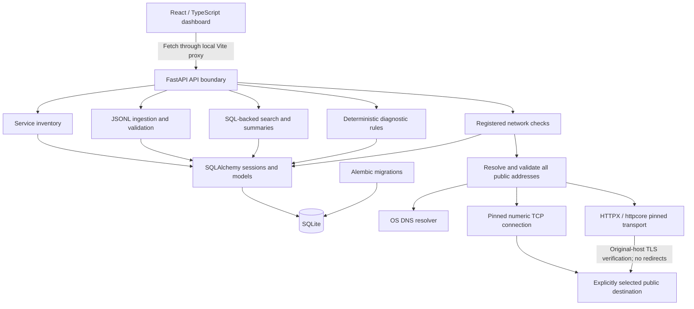

# Architecture and engineering decisions

IT Ops Lab is a modular monolith: one FastAPI application, one SQLite file, and a
separate React development UI. This is a learning and portfolio tool, not a claim
of distributed-system scale or production readiness.

## Boundaries

FastAPI is the sole application API boundary. Pydantic validates bodies, query
parameters and response contracts. Routes delegate to domain/persistence modules;
HTTP request objects are not required by the diagnostic engine. Expected network
failures are recorded observations rather than uncaught server errors. There is
no user authentication/authorization, so the API must remain on localhost.

SQLite was chosen to make local setup a file operation rather than another service.
It supports real relational queries, constraints, migrations and transactions.
SQLAlchemy provides parameter binding and request-scoped sessions; Alembic makes
schema evolution reviewable. SQLite's concurrency limits and broad Python dependency
ranges are honest trade-offs; a different deployment workload would need re-evaluation.

The React frontend uses Fetch, React Router and local state. It cannot open SQLite.
All writes pass through backend validation and transactions, including target safety
checks. Vite's development proxy avoids broad CORS changes. Built assets exist,
but production asset hosting and SPA fallback are not configured.

## Relationships

- Services own log batches and network targets.
- Batches own normalized events, safe ingestion errors and diagnostic runs.
- Runs own findings; `finding_events` associates findings with historical evidence.
- Targets own timestamped check results.

SQLite foreign-key enforcement is enabled on application connections. Uniqueness
protects service name/environment pairs, finding rule/run pairs, and evidence
associations. Appropriate batch/severity/time and target/history indexes support
implemented queries. There is no cascade-delete or editing API for historical events
and findings. See the API reference and engine guides for table columns.

## Investigation data flow

1. Register a service and upload raw UTF-8 JSON Lines. Bounded parsing rejects invalid
   records independently; a transaction stores valid UTC events and rejection counts.
2. Search SQL predicates by service, batch, severity, time and literal message phrase.
   SQL computes totals and summaries; the UI does not download all events to count them.
3. Explicitly analyze a batch with ruleset 1.0.0. Chronological rolling windows detect
   three timeout, five authentication, or two database failures at their defined severities.
   Evidence is the deduplicated union of qualifying windows. Static explanatory text
   avoids copying untrusted log content into conclusions.
4. Commit the run, findings and evidence associations together. Historical retrieval
   reads stored results; changing rules later must not rewrite old findings.
5. Register a network target and explicitly run a check. Resolve, validate every answer,
   connect only to a selected public IP, and persist the observation and UTC check time.
6. Compare evidence from different times before forming a hypothesis. A successful
   current connection does not disprove an earlier application-level failure.

## Why deterministic rules and isolated transport?

Phrase rules are understandable, reproducible and testable at exact thresholds and
window boundaries. They miss alternative wording and context; they are not AI or a
root-cause engine. Keeping the algorithm free of database/HTTP imports supports
small synthetic unit fixtures, including ties, overlap and negative examples.

Network operations are separate from target persistence and routes. The HTTP adapter
uses public httpcore interfaces to pin the connection while preserving hostname
verification and a shared I/O deadline. This adds a small maintenance surface and
an explicit compatible httpcore version range. It avoids a second hostname lookup,
unverified TLS, redirects, and credentials rather than weakening policy for a demo.
The OS resolver cannot be forcibly cancelled, so daemon workers are bounded to two.

Tests replace resolver/connect/probe functions and socket backends. The offline demo
uses scoped mocks with the same API/persistence path, not a permanently enabled
application bypass. Backend tests use migrated temporary databases; frontend tests
mock Fetch; Chromium checks use a disposable seeded file. No public connectivity is
required for automated verification.

## What would change for another workload?

Concurrent writers, long retention or large searches could justify PostgreSQL,
full-text indexes, lifecycle policies and query-plan measurement. Scheduled checks
would require authorization, bounded workers, operational ownership and alerting
policies. Public hosting would first require the controls in the security review.
These are future considerations, not implemented features or additional milestones.
