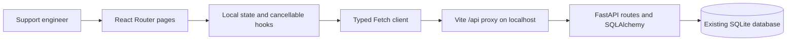

# Web dashboard

The dashboard is a local React/TypeScript application built with Vite, React Router,
native Fetch and plain CSS. Node 24 LTS is pinned in `frontend/.nvmrc`; Node 22.12+
is also supported. No UI framework, global state library, analytics, authentication,
background polling or additional backend is introduced.

## Structure and data flow



- `frontend/src/App.tsx`: shared sidebar, active navigation, skip link and routes.
- `src/pages/`: Overview, Services, Logs, Diagnostics and Network Checks.
- `src/components/`: shared headers, panels, status badges, states, pagination,
  paginated service selector, JSON/time display and an unexpected-data boundary.
- `src/api/client.ts`: one API base origin, JSON/raw-file requests, error handling,
  timeout and cancellation. `src/types/index.ts` mirrors actual response contracts.
- `src/hooks/useResource.ts`: cancellable read requests, 350 ms text debounce and
  explicit user-action state. No request caching or polling framework is needed.
- `src/styles/app.css`: restrained navy/neutral workspace, semantic status colors,
  responsive navigation, compact semantic tables and visible focus indicators.

React state holds transient forms, pending operations and selected upload results.
React Router query parameters retain investigation filters and record IDs. No log
contents are written to localStorage/sessionStorage or the browser console. React
renders messages and JSON as text, never as HTML. A page boundary handles malformed
response objects without removing navigation. This is not a full runtime schema
validation framework; backend response models remain authoritative.

The UI cannot open SQLite. Every operation goes through existing FastAPI validation,
transaction and network safety boundaries. Sending data directly to SQLite would
bypass these protections and require unsafe browser filesystem access.

## Development configuration

Use two terminals from the repository root. Windows PowerShell backend:

```powershell
.\.venv\Scripts\Activate.ps1
python -m pip install -e '.[dev]'
python -m alembic upgrade head
python -m uvicorn app.main:create_app --factory --reload --host 127.0.0.1
```

Frontend, with Node 24 LTS installed:

```powershell
cd frontend
npm ci
npm run dev
```

The backend uses `127.0.0.1:8000`; Vite uses `127.0.0.1:5173` and proxies `/api` to
FastAPI. Both bind only to localhost. No CORS wildcard or disabled browser security
is needed. Use the Vite page in your local browser. API docs remain at backend `/docs`.
`npm install` also works when intentionally updating dependencies; commit the lockfile.
If a cloud runner has an unwritable default npm cache, pass a writable `--cache` path
to npm; normal Windows installations should use their standard cache.

Copy `frontend/.env.example` to `.env.local` only when overriding configuration:
`VITE_API_BASE_URL` is an optional base origin without `/api`, default empty for the
proxy. An alternate origin still needs a deliberately configured same-origin proxy
or narrow CORS setup; this milestone does not enable cross-origin access. Keep it
local. `VITE_API_TIMEOUT_MS` defaults to 15000, accepting 1000–60000 ms. Vite variables
are public build configuration, never a place for credentials. Restart Vite after
changing environment files. There are no embedded credentials; Fetch omits cookies.

## Read-only backend additions

Existing write contracts are unchanged. Three endpoints fill actual discovery gaps:

| Endpoint | Behavior |
| --- | --- |
| GET `/api/v1/dashboard` | Exact SQL counts for services/events/errors+critical/warnings; latest five stored findings and observations |
| GET `/api/v1/services/{id}/log-batches` | Service-scoped batch page with items, total, offset and limit |
| GET `/api/v1/log-batches/{id}/diagnostic-runs` | Batch-scoped historical run page with finding counts |

Discovery pages default to offset 0, limit 50, maximum 100. Missing parents return
404, invalid pagination/IDs return 422. Lists order by creation/start time descending,
then ID descending. Finding counts use SQL, not loaded evidence. Overview counts use
SQL aggregation; only bounded recent records reach the browser. Errors include ERROR
and CRITICAL, as clearly labeled. No numbers are inferred from one page or fabricated
when the API fails: unavailable metrics show a dash and an error. Empty database
counts are genuinely zero. No database migration is required for the dashboard.

## Pages, filters and pagination

**Overview** displays exact totals and recent persisted findings/network observations.
Links carry service/run/finding or target/result context into investigation pages.
There are no decorative charts or invented activity records. Reload/navigation
refreshes data; no periodic polling is enabled. Counts are live queries, not an
immutable cross-query snapshot during concurrent writes.

**Services** pages through inventory, creates services, reads selected details, and
links to logs/network checks. Server validation and uniqueness errors are displayed.
The shared service selector is paginated in 50-row chunks; it does not silently cap
the available service inventory at 50 records.

**Logs** uses server-side filters and pagination, including time/severity/service/
batch/message/offset/limit in the URL. Free-text message search waits 350 ms. Read
requests abort on changing filters or unmount, preventing stale results replacing
new selections. Times require ISO 8601 with timezone and are shown in UTC. The
severity summary intentionally follows only service, batch and time filters because
that is the existing summary contract; this scope is labeled separately from the
filtered event table. Open an event for original text and formatted metadata.

Upload through the same page after selecting a service. The browser checks `.jsonl`
and 1 MiB, then sends the File directly as raw `application/x-ndjson` bytes with its
filename query parameter. No multipart encoding, reserialization or storage is used.
The backend remains authoritative on encoding/record validation. Accepted/rejected
counts and paginated safe ingestion errors are shown, with links to batch logs and
diagnostics. Clear filters resets the search. Large messages wrap within scrollable
tables rather than expanding the whole page.

**Diagnostics** discovers service batches and batch run history without manually
entering IDs. Run analysis requires a click; refresh and GET never trigger analysis.
The response displays stored version, status, findings, suggested investigations,
evidence counts and times. Evidence detail uses the existing finding endpoint. Zero
findings is a valid completed result. URL IDs reopen historical records.

**Network Checks** discovers registered targets, submits type-specific configurations,
executes only a selected enabled target on click, pages historical observations,
and reads result details. DNS omits port/scheme/path; TCP sends port only; HTTP
starts with HTTPS/443 and `/`. Backend destination validation cannot be bypassed.
Observed time, duration, exact HTTP status and error code are shown. A successful
HTTP check does not prove every application component is healthy. Public-only
restrictions and the difference between current and historical observations remain
visible. Selecting a target on a later inventory page may require paging to that
record before using its Run button.

## Errors, timeouts and accessibility

The API client reports backend detail/validation messages, unavailable servers,
invalid JSON and request timeouts. Aborting a client request does not necessarily
cancel an already-started server write. On a timed-out upload/run, inspect persisted
history before retrying to avoid creating another batch/run. Mutation buttons are
disabled while pending; navigation aborts pending client requests. There is no
optimistic success or automatic POST retry.

Forms have labels and native required/length/number constraints, with backend errors
as alerts. User-triggered completion has status announcements. Status badges include
words rather than color alone. Navigation uses actual links and active-route states;
buttons/selects are keyboard controls. A skip link targets the main region. Tables
retain headings and horizontal scrolling on narrow screens. There are no modals,
focus traps, autoplay or animated visualizations. Full screen-reader certification
has not been performed.

## Retail POS walkthrough

1. Open Services and create `Retail POS` in environment `demo`.
2. Follow its Logs link and upload `samples/retail-pos.jsonl`.
3. Review eight accepted records, filter severity ERROR, and inspect the three
   database timeout events. Open one to examine metadata safely.
4. Follow the upload's Analyze link, or choose the service and batch in Diagnostics.
   Click Run diagnostics. Inspect the two HIGH findings and their three supporting
   event IDs. Suggested actions are investigation directions, not confirmed causes.
5. In Network Checks, select the service and register authorized public DNS/TCP/HTTP
   targets. Registration alone makes no network request. Only click Run if you intend
   to contact that configured public service. Inspect persisted results and compare
   `checked_at` to the historical log times.
6. Return to Overview for actual counts and links to the new findings/observations.

For repeatable offline backend observations, use the existing
`scripts/demo_network_diagnostics.py`; it intentionally uses its own temporary
ASGI-test workflow, so it does not populate your dashboard's database. Dashboard
browser verification instead used a disposable SQLite file and a test-only backend
network mock. No simulation bypass is added to the application UI or production
network code. Captured screenshots use synthetic persisted data, and the network
target is explicitly labeled simulated.

## Verification and screenshots

```powershell
# Repository root
python -m pytest
python -m ruff check .
python -m ruff format --check .
# frontend/
npm test
npm run typecheck
npm run build
```

Vitest and React Testing Library mock Fetch; no external calls are needed. Tests
cover navigation, creation, filters/pagination, details, raw upload, diagnostics,
evidence, all target forms, result history, errors, states, URL filters and aborts.
Backend tests cover aggregates and scoped discovery. Browser checks used Chromium
on Linux through the Vite proxy for actual upload, diagnostics/evidence, target
creation, mocked network runs, persisted history, desktop/mobile layout and keyboard
skip navigation. Windows commands are documented, but Windows itself was not tested.

Screenshots: `docs/screenshots/overview.png`, `logs.png`, and `logs-mobile.png`.
To refresh them, follow the synthetic walkthrough, use a desktop viewport around
1440×1080 and a narrow viewport around 390×844, and capture only synthetic records.
No real customer data or credentials belong in portfolio screenshots.

## Extending later

Add new pages through React Router, type the actual API contract, and reuse the
cancellable client/state components. Keep large datasets paginated in FastAPI and
aggregates in SQL. Do not add background polling, infrastructure, authentication,
public deployment or new backend behavior as part of this milestone. `npm run build`
produces static assets in ignored `frontend/dist`; deploying or serving those assets
alongside FastAPI remains separate work. Vite's development proxy is not embedded in
production assets; the future host must provide same-origin `/api` and SPA fallback.
