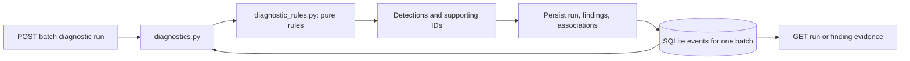

# Deterministic diagnostics

The engine highlights observed patterns and suggested checks. Findings are evidence
for an investigation, not confirmed root causes. It uses no AI service, regular
expression execution, dynamic evaluation, or commands from log messages.

## Ruleset 1.0.0

| Rule code | Matching severities | Threshold / window | Finding severity |
| --- | --- | --- | --- |
| REPEATED_TIMEOUTS | ERROR, CRITICAL | 3 / 5 minutes | HIGH |
| REPEATED_AUTH_FAILURES | WARNING, ERROR, CRITICAL | 5 / 10 minutes | MEDIUM |
| DATABASE_CONNECTION_ERRORS | ERROR, CRITICAL | 2 / 5 minutes | HIGH |

Timeout phrases: `connection timed out`, `request timed out`, `connection timeout`,
`upstream timeout`. Authentication phrases: `authentication failed`, `login failed`,
`invalid credentials`, `unauthorized request`. Database phrases:
`database connection failed`, `database connection timed out`, `connection pool exhausted`,
`could not connect to database`.

Matching is literal substring matching after Python `casefold()`. Severity is checked
first. A message matching several phrases for one rule counts only once. A database
timeout may independently match the timeout and database rules; sharing evidence
across rules is intentional. Metadata and source do not trigger rules. Static
summaries, explanations, and suggested checks never incorporate uploaded strings.
The evidence detail endpoint intentionally returns the original supporting messages.

## Rolling windows and evidence

The coordinator loads only events belonging to the requested batch (at most 10,000,
from the existing ingestion limit). The pure engine accepts normalized `Event`
objects without SQLAlchemy or FastAPI. It deduplicates IDs and sorts by event time
ascending, then ID ascending. Database naive timestamps represent UTC; standalone
callers must supply consistent normalized UTC timestamps, not mixed naive/aware values.

For each rule:

1. Discard unrelated messages and unsupported severities.
2. Move a right pointer through chronological matching events.
3. Advance the left pointer while the span exceeds the rule's window. Equality
   qualifies: for example, 13:00:00 and 13:05:00 are within five minutes.
4. When the current inclusive interval has enough events, mark all its events as
   supporting evidence.
5. Return the union of the marked intervals, chronologically ordered and without
   duplicate IDs. Produce at most one finding for that rule in the batch.

The code uses a difference array to mark intervals without repeatedly copying
large overlapping slices. Sorting costs O(n log n); each rule's scan and interval
union cost O(n). There are three fixed rules, and input is bounded.

These are rolling intervals, not fixed clock buckets. Three timeout events at
13:04:59, 13:05:00, and 13:05:01 qualify even though they cross a five-minute clock
boundary. Isolated matching events outside every qualifying interval are excluded.
Two separate qualifying clusters produce one finding with the union of both
clusters. Therefore a finding's first/last timestamps may span longer than five or
ten minutes: each supporting event belongs to a qualifying window, but the entire
union need not fit a single window. Unrelated events between clusters are excluded.
Upload time is never used to evaluate windows; identical timestamps remain distinct
when event IDs differ. No rule combines batches, even for the same service.

## Persistence and consistency

The new Alembic revision adds:

- `diagnostic_runs`: batch foreign key, ruleset version, constrained status, UTC
  start/finish timestamps. `running` exists only during the transaction; successful
  API responses and committed runs are `completed`. Failed attempts leave no run
  record, so there is no persisted `failed` status in this milestone.
- `findings`: run foreign key, rule code, severity, static explanatory text,
  first/last supporting timestamps, and positive evidence count. A unique constraint
  on `(run_id, rule_code)` prevents duplicate rule findings within a run. Severities
  are constrained to HIGH or MEDIUM for the current ruleset.
- `finding_events`: composite primary key `(finding_id, event_id)` plus foreign keys
  to findings and historical events. It prevents duplicate evidence associations.

The existing service is reached through run -> batch -> service; no redundant
service ID is stored in these new tables. Existing event rows are not rewritten.
The run/rule unique index supports listing findings for a run; the evidence primary
key supports finding-scoped evidence lookups. Primary-key lookups handle run/finding
retrieval. No extra standalone indexes or cascading deletes are needed by these
endpoints. All application connections enforce SQLite foreign keys. Persistence
selects and links only events from the run's batch; raw SQL access is outside this
API contract.

One transaction creates the run, analyzes the bounded event list, inserts findings
and associations, marks completion, and builds the response before committing.
Failure during processing, flush, response construction, or commit rolls back the
whole new run. Existing services, batches, events, and historical diagnostic runs
remain intact. Errors return a generic HTTP 500 rather than database traces.
Server logs remain available for local diagnosis; SQL parameter values are hidden
by the existing engine configuration.

A zero-match batch, including an entirely rejected batch with no accepted events,
produces a completed run with no findings. Repeating POST creates a new run ID and
new finding IDs; it does not overwrite or deduplicate previous runs. Retrieving a
historical run uses stored findings and associations rather than rerunning rules.
Increment the ruleset version when rule behavior or static text changes, and retain
the corresponding code revision to replay that version. There is no API to request
an arbitrary older engine version or edit historical findings.

## API ordering and bounds

Run responses include batch/service ownership, stored version, status, UTC timestamps,
finding count, and findings with supporting IDs. Findings are ordered by rule code,
then ID. Finding detail adds evidence sorted by occurred_at, then ID ascending,
with source, severity, and message. All datetimes serialize in UTC with `Z`.
Queries are scoped and limited: input/evidence at 10,000 events, and historical
finding retrieval at 10,000 findings (the current engine produces at most three).
Details return all bounded evidence rather than a truncated page. Large supported
batches can therefore produce large responses. Integer IDs must be positive and
fit SQLite's signed 64-bit integer range.

## Application Support and IT Operations use

Upload the synthetic POS sample, search its ERROR events, execute diagnostics, and
compare the linked event IDs to the original search results. Its three database
timeouts produce both REPEATED_TIMEOUTS and DATABASE_CONNECTION_ERRORS, each with
three supporting events from 13:05 to 13:07 UTC. Startup, success, recovery, and the
single authentication warning are not evidence for those findings. The separate
`auth-failures.jsonl` sample triggers the authentication rule exactly at its inclusive
ten-minute boundary.

An incident report can cite service, batch, run ID, ruleset version, finding IDs,
UTC first/last times, evidence counts, and supporting event IDs. A reasonable
hypothesis is intermittent connectivity or connection-pool pressure. Check upstream
health, network reachability, pool usage/limits, and relevant configuration before
confirming a cause. Authentication failures alone do not prove compromise; investigate
identity-provider state, configuration changes, and lockouts separately.

## Limitations and validation

Literal phrases can miss alternative wording and can match quoted failure messages
that are not current failures. Rules do not infer causality, group across batches,
use metadata context, or distinguish separate incidents within a union finding.
The engine is synchronous, local, and intended for small bounded uploads. No
scheduling, workers, authentication, network probes, AI analysis, or frontend is added.

Tests cover thresholds, inclusive boundaries, overlapping/disjoint windows, input
ordering, repeated timestamps, supported phrases/severities, safe static text,
batch isolation, persistence/restarts, historical runs, foreign keys/uniqueness,
rollback at several stages, and migration preservation. Use temporary databases
for validation. Downgrading to `67136625fb8f` drops diagnostic history only; it
preserves earlier inventory and logs. Back up any diagnostic history before a
manual downgrade. Re-upgrade recreates empty diagnostic tables, not dropped runs.
