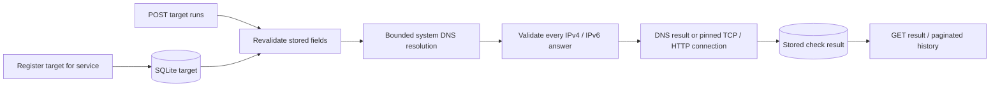

# Network diagnostics: connectivity evidence, not root-cause proof

These local, user-initiated checks complement log search and rule-based diagnostics.
They do not run during startup, migrations, target registration, or GET requests.
No commands, shell tools, authentication, workers, scanners, or cloud services are
involved. Treat every result as an observation at its recorded UTC `checked_at`.



## What each check proves

**DNS** maps a hostname to addresses using the OS resolver's `getaddrinfo`, requesting
stream-socket-compatible IPv4/IPv6 addresses. Successful resolution says nothing
about whether a port is open or an application is healthy. Resolver failure is
`DNS_ERROR`; a bounded wait expiring is `TIMEOUT`. Literal IP targets skip DNS and
report that address. There is no custom DNS server or authoritative record query.

**TCP** establishes one connection to one approved address/port and immediately
closes it. Success demonstrates a TCP connection, not valid SQL credentials, a
healthy database, or application readiness. Refusal means the connection was
actively rejected (`CONNECTION_REFUSED`); timeout means the attempt did not complete
within the budget. Routing, filtering and endpoint state may all contribute.
Only the first deterministically sorted approved address is attempted; a failed
first address does not prove all addresses are unreachable. No retries or port
ranges are implemented. Every socket is closed on success or failure.

**HTTP** sends GET for the registered scheme, hostname, port and path. HTTPX handles
request/response semantics, using the small `network_transport.py` adapter over
public httpcore APIs. HTTP 200–399 is successful, per this project's contract;
404/500 and other statuses outside that range are recorded as `HTTP_STATUS`, with
the exact status retained. Redirects are **not followed**, even to a public host:
a 302 is a successful response from the original endpoint with
`redirect_not_followed: true`, not proof the redirected endpoint is healthy.

**HTTPS/TLS** additionally verifies the certificate chain and the original registered
hostname, using `ssl.create_default_context()` with certificate verification and
hostname checking enabled. SNI also uses that original hostname. Certificate failures
are `TLS_ERROR`; other connection failures are `CONNECTION_ERROR`. These differ from
an HTTP 500 response: TLS/connection failures occur before a usable HTTP status.
A valid certificate does not prove application correctness.

## Registration and validation

POST `/api/v1/services/{service_id}/check-targets` accepts a name, check_type (`DNS`,
`TCP`, `HTTP`), host, optional port/path/scheme, and strict boolean enabled (default
true). No DNS lookup happens during registration. Hosts must be bare public IPs or
ASCII dotted DNS names; URL schemes, user-info, embedded ports, whitespace, scoped
IPv6, legacy numeric address forms and local names are rejected. Unicode hostnames
must first be represented as ASCII DNS labels; no implicit URL parsing is performed.

DNS targets do not accept a port, path or scheme. TCP requires a port 1–65535 and
accepts neither path nor scheme. HTTP adds an explicit `scheme` field to the requested
target schema so HTTP and HTTPS are unambiguous: default HTTPS/443, or HTTP/80.
Custom ports are permitted. HTTP paths default to `/` and must be plain absolute
ASCII paths without query strings, percent escapes, fragments, controls, whitespace,
backslashes or a leading `//`. This deliberately small interface excludes credential
URLs and sensitive query parameters. Unknown request fields fail validation.

GET `/api/v1/services/{service_id}/check-targets` lists registered configurations in
ID order, with offset/limit pagination. Run endpoints accept no destination override
(the optional empty body rejects unknown fields). Stored targets are revalidated
immediately before execution. Disabled targets return 409 without making a request.
There is no target-edit endpoint in this milestone; `enabled` is chosen at registration.

## Public-only boundaries and rebinding defense

Registration rejects unsafe IP literals; execution resolves hostnames and checks
**every** returned address. Any unsafe answer rejects the entire result before a
connection. The policy denies non-global, private, loopback, link-local, unspecified,
multicast and reserved addresses for IPv4 and IPv6. It also explicitly denies special
metadata/platform endpoints, IPv4-mapped IPv6 and NAT64/6to4/Teredo translation ranges
that might otherwise reach prohibited networks. Private or local checks are not
available, including for demonstrations. Registration grants the local trusted user
permission to run that one target; it is not proof of ownership of a public service.
Only register destinations you are authorized to diagnose.

TCP passes the approved numeric IP directly to a socket of the correct address
family. HTTP's pinned backend receives the original hostname, but gives only the
selected validated numeric address to httpcore's socket backend, then verifies the
OS-reported peer address **before TLS or HTTP bytes are sent**. TLS and Host retain
the original hostname. There is no second lookup of the hostname between validation
and connection, no default HTTPX connection fallback, no redirects, and no reuse of
connections across check invocations. A changed DNS answer on the next invocation
is validated again. Tests cover mixed answers, peer mismatch, unsafe destinations,
and the actual HTTP backend's numeric connection and original-host TLS behavior.

This guards application-level DNS rebinding/TOCTOU; it cannot attest to external NAT,
transparent interception, route changes, a compromised OS resolver or network stack,
or the behavior of a remote public server. `is_global` uses the installed Python
address registry plus explicit denials and should be reviewed with Python upgrades.

Proxy environment variables, `.netrc` credentials and environment cookies are not
used (`trust_env=False`, one fresh client per check). No proxy is configured. A
proxy-only/VPN-mediated environment may therefore fail even if another tool works.
Checks remain subject to the host's egress policy. Do not disable TLS verification
or private-address protection to work around routing failures. Use the offline demo
where direct public connections are unavailable. There is no proxy-auth support.

## Time and response bounds

`IT_OPS_NETWORK_TIMEOUT_SECONDS` defaults to 3 seconds, constrained to 0.1–10 seconds.
DNS receives that budget; TCP/HTTP receive the remaining time. The HTTP stream uses
a shared deadline across TCP connection, TLS, writes and reads so a slow header trickle
cannot reset a per-read timeout indefinitely. Minor setup/serialization overhead is
outside socket timing. No response bodies are iterated, decoded, or persisted.

HTTP bounds application wire reads to 64 KiB while obtaining headers, rejects parsed
headers over 16 KiB, and rejects declared Content-Length above 1 MiB as
`RESPONSE_TOO_LARGE`. Socket reads may prefetch some body bytes together with headers;
those bounded bytes are discarded on close. Unknown-length/chunked bodies are not
read. HTTP status is retained when available. Malformed response framing is a
recorded `HTTP_PROTOCOL_ERROR` or connection failure, not an unhandled exception.

Python's standard-library DNS lookup cannot be forcibly cancelled. The caller's
wait is bounded using at most two daemon resolver workers, with no queued tasks.
A timed-out OS lookup can continue in its worker until the OS returns; its slot
remains occupied, and further checks return `DNS_BUSY` if both slots are busy.
There is no unlimited executor growth, and daemon lookups do not block process exit.

## Results and errors

POST `/api/v1/check-targets/{target_id}/runs` returns HTTP **201** for both successful
observations and expected network failures, including an unsafe DNS answer. This
records failed attempts for incident evidence. Inspect `outcome` and `error_code`:

| Code | Meaning |
| --- | --- |
| null | Successful DNS, TCP, or HTTP 200–399 observation |
| DNS_ERROR | Resolver failed or returned no addresses |
| DNS_BUSY | Both bounded resolver slots are occupied |
| TIMEOUT | Resolution, connection, TLS or HTTP deadline expired |
| CONNECTION_REFUSED | TCP actively refused the connection |
| CONNECTION_ERROR | Other socket/HTTP connection failure |
| TLS_ERROR | Certificate verification failed |
| HTTP_STATUS | HTTP response outside 200–399; inspect status_code |
| HTTP_PROTOCOL_ERROR | Invalid HTTP response framing/headers |
| RESPONSE_TOO_LARGE | Parsed headers or declared response length exceeded limits |
| UNSAFE_DESTINATION | An address was not permitted; no connection was made to it |

Invalid registration returns 422. Missing service/target/result returns 404. Disabled
or invalid stored configuration returns 409. Unexpected persistence failures return
a generic 500 and roll back the new result. Raw exception text, headers, cookies,
response bodies, credentials and stack traces are never stored in results.
`details_json` contains only configured host/port/type, validated addresses, the
selected address for attempted connections, and fixed flags. `connected_address`
identifies the address selected for an attempt, even if the connection failed.

`check_targets.service_id` references services. `check_results.target_id` references
the registered target, with enforced foreign keys. The service-target index supports
configuration listing; `(target_id, checked_at)` supports scoped newest-first history,
with result ID descending as a tie-breaker. GET target results defaults to offset 0,
limit 50, maximum 100; GET `/api/v1/check-results/{result_id}` retrieves one observation.
These list endpoints return arrays, consistently with earlier inventory/history APIs.
Timestamps are stored as naive UTC and returned with `Z`. No automatic result pruning
or update/delete API is implemented.

## Repeatable POS investigation, fully offline

From the repository root after installing `.[dev]`, on Windows PowerShell:

```powershell
.\.venv\Scripts\python.exe scripts/demo_network_diagnostics.py
```

On Linux/macOS use `python scripts/demo_network_diagnostics.py`. This runs local
ASGI requests through TestClient, builds a temporary migrated database, uploads the
existing synthetic POS logs, executes the existing diagnostic rules, and registers
DNS/TCP/HTTPS targets. Controlled network mocks produce DNS success, TCP timeout and
HTTP 503. The output explicitly says **SIMULATED**. No public or private service is
contacted and the developer's database is never opened. PowerShell itself was not
available during Linux validation; the same Python demo was executed here.

The synthetic historical log errors occurred at 13:05–13:07 UTC. Diagnostic findings
identify their supporting IDs. The simulated network checks are recorded at the
current observation time, which is deliberately different. This evidence suggests
checks for database/upstream availability, routing, connection-pool pressure, and
configuration; it does **not** establish that a current timeout caused an earlier
application error.

For real investigations: inspect ERROR events and findings first, review the target,
initiate one authorized check, retrieve its saved result, compare timestamps, and
write a hypothesis with its limits. DNS failure suggests investigating naming and
resolver configuration; successful DNS followed by TCP failure shifts attention to
routing/filtering/listeners; successful TCP with HTTP 500 suggests an application
response error; TLS errors suggest trust, certificate validity or hostname issues.
An application database failure can occur despite healthy DNS/TCP/HTTP if pools,
credentials or database logic are wrong.

This maps to CCNA concepts: name-to-address resolution, Layer 3 routing versus Layer 4
connection establishment, port/listener behavior, and application-layer protocols.
TLS adds identity verification, not a guarantee of business correctness. Separate
those layers and cite observed times rather than guessing one cause from one symptom.
